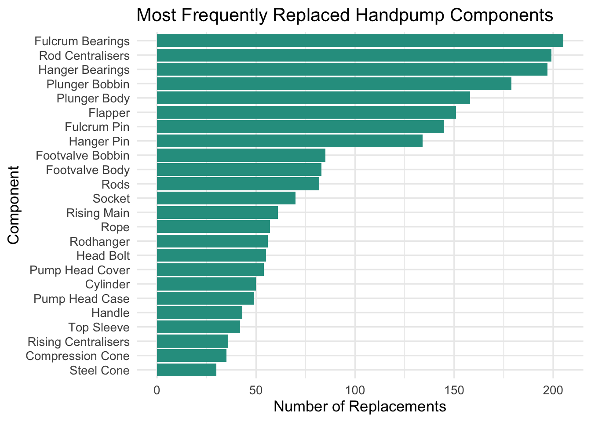

# USAID Flood Response Rehabilitation and Chlorination Survey

This dataset originates from the USAID Flood Response Rehabilitation and
Chlorination Survey, conducted between 2019 and 2020 in Mulanje
District, Malawi. The data was collected using the mWater mobile
platform by field teams working to assess, rehabilitate, and chlorinate
rural handpump-equipped water points affected by flooding.

The dataset includes detailed records on:

- Borehole component condition before and after rehabilitation
- Chlorination activities
- Community mobilization
- Environmental risks near water points
- Functionality status and water access metrics post-rehabilitation

Photos and GPS coordinates are embedded via cloud-linked URLs to provide
visual and spatial evidence of the rehabilitation process.

**Potential Use Cases**

1.  WASH Program Monitoring and Evaluation

- Track the impact of rehabilitation efforts on water point
  functionality.

- Monitor the effectiveness of chlorination in flood-prone regions.

2.  Infrastructure Asset Management

- Identify components frequently requiring replacement.

- Schedule preventive maintenance and prioritize resources.

3.  Disaster Response Planning

- Map flood-affected water infrastructure and assess repair timelines.

- Use historical damage and repair data to prepare for future climate
  shocks.

4.  Public Health Risk Assessment

- Analyze the relationship between water source integrity and
  contamination risks (e.g., proximity to latrines or cemeteries).

5.  Policy and Program Design

- Guide government and donor decisions on where and how to invest in
  resilient rural water systems.

6.  Training and Capacity Building

- Use the data and photos as case studies for training technicians or
  water committees.

Potential Users of this data

1.  Government agencies (e.g., Ministry of Water, District Water
    Offices)

2.  NGOs and implementing partners involved in WASH and emergency
    response

3.  Donor agencies such as USAID, to assess project outcomes and guide
    future funding

4.  Researchers and public health analysts studying the impacts of
    infrastructure damage and recovery

5.  Water point mechanics and private sector suppliers, to inform
    maintenance and procurement planning

6.  Community-based organizations (CBOs) and Water Point Committees, for
    local monitoring and advocacy

## Installation

You can install the development version of floodchlorinationsurvey from
[GitHub](https://github.com/) with:

``` r

# install.packages("devtools")
devtools::install_github("openwashdata/floodchlorinationsurvey")
```

``` r

## Run the following code in console if you don't have the packages
## install.packages(c("dplyr", "knitr", "readr", "stringr", "gt", "kableExtra"))
library(dplyr)
library(knitr)
library(readr)
library(stringr)
library(gt)
library(kableExtra)
```

Alternatively, you can download the individual datasets as a CSV or XLSX
file from the table below.

1.  Click Download CSV. A window opens that displays the CSV in your
    browser.
2.  Right-click anywhere inside the window and select “Save Page As…”.
3.  Save the file in a folder of your choice.

| dataset | CSV | XLSX |
|:---|:---|:---|
| floodchlorinationsurvey | [Download CSV](https://github.com/openwashdata/floodchlorinationsurvey/raw/main/inst/extdata/floodchlorinationsurvey.csv) | [Download XLSX](https://github.com/openwashdata/floodchlorinationsurvey/raw/main/inst/extdata/floodchlorinationsurvey.xlsx) |

## Data

The package provides access to the USAID Flood Response Rehabilitation
and Chlorination Survey, conducted between 2019 and 2020 in Mulanje
District, Malawi.

``` r

library(floodchlorinationsurvey)
```

### floodchlorinationsurvey

The dataset `floodchlorinationsurvey` contains 328 observations and 118
variables

``` r

floodchlorinationsurvey |> 
  head(3) |> 
  gt::gt() |>
  gt::as_raw_html()
```

| submitted_on | water_point_name | latitude | longitude | chlorination_rehab_date | community_mobilised | functional_status_before | rating_bolts_nuts | rating_compression_cone | rating_cylinder | rating_flapper | rating_footvalve_bobbin | rating_footvalve_body | rating_footvalve_oring | rating_fulcrum_pin | rating_fulcrum_bearings | rating_handle | rating_hanger_pin | rating_hanger_bearings | rating_head_bolt | rating_plunger_bobbin | rating_plunger_body | rating_plunger_useal | rating_pump_head_case | rating_pump_head_cover | rating_rising_main | rating_rising_centralisers | rating_rods | rating_rod_centralisers | rating_rodhanger | rating_rope | rating_socket | rating_steel_cone | rating_top_sleeve | rod_count | broken_parts_fished_out | broken_parts_comments | silt_observed | corrosion_observed | slime_observed | rising_main_length_m | rope_attached | photos_of_removed_parts | pedestal_condition | pedestal_firm | photos_of_civil_work | latrines_within_30m | latrines_within_100m | cemetery_within_30m | waste_dumps_within_30m | difficult_access_by_car | chlorination_done | parts_chlorinated | parts_chlorinated_unknown | borehole_depth_m | water_depth_m | chlorine_water_buckets | hth_dissolved_properly | chlorinated_parts_installed | replaced_rising_main_length_m | replaced_rod_count | replaced_bolts_nuts_tick | replaced_bolts_nuts_count | replaced_compression_cone_tick | replaced_compression_cone_count | replaced_cylinder_tick | replaced_cylinder_count | replaced_flapper_tick | replaced_flapper_count | replaced_footvalve_bobbin_tick | replaced_footvalve_bobbin_count | replaced_footvalve_body_tick | replaced_footvalve_body_count | replaced_footvalve_oring_tick | replaced_footvalve_oring_count | replaced_fulcrum_pin_tick | replaced_fulcrum_pin_count | replaced_fulcrum_bearings_tick | replaced_fulcrum_bearings_count | replaced_handle_tick | replaced_handle_count | replaced_hanger_pin_tick | replaced_hanger_pin_count | replaced_hanger_bearings_tick | replaced_hanger_bearings_count | replaced_head_bolt_tick | replaced_head_bolt_count | replaced_plunger_bobbin_tick | replaced_plunger_bobbin_count | replaced_plunger_body_tick | replaced_plunger_body_count | replaced_plunger_useal_tick | replaced_plunger_useal_count | replaced_pump_head_case_tick | replaced_pump_head_case_count | replaced_pump_head_cover_tick | replaced_pump_head_cover_count | replaced_rising_main_tick | replaced_rising_main_count | replaced_rising_centralisers_tick | replaced_rising_centralisers_count | replaced_rods_tick | replaced_rods_count | replaced_rod_centralisers_tick | replaced_rod_centralisers_count | replaced_rodhanger_tick | replaced_rodhanger_count | replaced_rope_tick | replaced_rope_count | replaced_socket_tick | replaced_socket_count | replaced_steel_cone_tick | replaced_steel_cone_count | replaced_top_sleeve_tick | replaced_top_sleeve_count | functionality_after | time_to_fill_20l_bucket | strokes_to_yield_water |
|---:|:---|---:|---:|---:|:---|:---|---:|---:|---:|---:|---:|---:|---:|---:|---:|---:|---:|---:|---:|---:|---:|---:|---:|---:|---:|---:|---:|---:|---:|---:|---:|---:|---:|---:|:---|:---|:---|:---|:---|---:|:---|:---|:---|:---|:---|:---|:---|:---|:---|:---|:---|:---|:--:|---:|---:|---:|:---|:---|---:|---:|:--:|---:|:--:|---:|:--:|---:|:--:|---:|:--:|---:|:--:|---:|:--:|---:|:--:|---:|:--:|---:|:--:|---:|:--:|---:|:--:|---:|:--:|---:|:--:|---:|:--:|---:|:--:|---:|:--:|---:|:--:|---:|:--:|---:|:--:|---:|:--:|---:|:--:|---:|:--:|---:|:--:|---:|:--:|---:|:--:|---:|:--:|---:|:---|---:|---:|
| 2019-06-25 | Beseni borehole | -15.62573 | 35.51046 | 2019-06-13 | Yes | Partially Functional | 2 | 2 | 1 | NA | 2 | 1 | 2 | 1 | 3 | 2 | 1 | 2 | 2 | 2 | 1 | 3 | 2 | 2 | 2 | 4 | 4 | 4 | 2 | 2 | 2 | 1 | 1 | 10 | No | NA | No | No | No | 32 | Yes | <https://api.mwater.co/v3/images/9771504bd95c41a1a7a38e1af82fd277>; <https://api.mwater.co/v3/images/c776abcd2d1f41e493096e42ce544089> | Minimal Wear | Yes | <https://api.mwater.co/v3/images/1aa6be33360f448a90deafc9f595c356>; <https://api.mwater.co/v3/images/d4712dad2a054007b26a5212f36e0bd4>; <https://api.mwater.co/v3/images/31c8b2e57f9e4064bb1139f02ea547a2> | Yes | Yes | No | No | No | No | Yes | NA | NA | NA | NA | NA | NA | 32 | 10 | NA | NA | NA | NA | NA | NA | NA | NA | NA | NA | NA | NA | NA | NA | NA | NA | TRUE | 2 | NA | NA | NA | NA | NA | NA | NA | NA | NA | NA | NA | NA | TRUE | 1 | NA | NA | NA | NA | NA | NA | NA | NA | TRUE | 1 | TRUE | 7 | NA | NA | NA | NA | NA | NA | NA | NA | NA | NA | Functional | 58.021 | 1 |
| 2019-12-03 | Demula borehole 3 | -15.96436 | 35.47770 | 2019-06-13 | Yes | Non-functional | 2 | 2 | 2 | 2 | 2 | 2 | 2 | 2 | 5 | 2 | 3 | 2 | 2 | 2 | 2 | 5 | 2 | 3 | 2 | 2 | 2 | 5 | 2 | 2 | 3 | 2 | 2 | 7 | No | NA | No | No | Yes | 21 | Yes | <https://api.mwater.co/v3/images/309d5867adcc468fb9a985cb3c9a046f>; <https://api.mwater.co/v3/images/8933e817678845fb8031c9fdeb494b57>; <https://api.mwater.co/v3/images/2b7ba1ef4e0649fb8f1cdc509da7b0c4> | Minimal Wear | Yes | <https://api.mwater.co/v3/images/39f2280d44bc4e089557f4c996bd8881>; <https://api.mwater.co/v3/images/89853756161544ac82551de15852dd5b>; <https://api.mwater.co/v3/images/485d8dbd0bad4881932d1374b0943fff>; <https://api.mwater.co/v3/images/fbf80bda9e604682b69570ee7d85bf37> | No | Yes | No | No | No | No | No | NA | NA | NA | NA | NA | NA | 28 | 8 | NA | NA | NA | NA | NA | NA | NA | NA | NA | NA | NA | NA | NA | NA | NA | NA | TRUE | 2 | NA | NA | NA | NA | FALSE | NA | NA | NA | TRUE | 1 | TRUE | 1 | TRUE | 1 | NA | NA | NA | NA | NA | NA | NA | NA | NA | NA | TRUE | 4 | NA | NA | NA | NA | NA | NA | NA | NA | NA | NA | Functional | 49.560 | 1 |
| 2020-02-22 | Demula borehole 3 | -15.96436 | 35.47770 | 2019-06-13 | Yes | Partially Functional | 5 | 2 | 2 | 3 | 2 | 2 | 3 | 2 | 5 | 2 | 5 | 5 | 2 | 2 | 3 | 2 | 2 | 2 | 2 | 2 | 2 | 2 | 3 | 2 | 2 | 2 | 2 | 9 | No | NA | No | No | No | 27 | Yes | <https://api.mwater.co/v3/images/4290a43e7ed84e079f9a1dcbe7212a07>; <https://api.mwater.co/v3/images/3b9fd7f215db46779387c126afc87ffc> | Minimal Wear | Yes | <https://api.mwater.co/v3/images/1dda964691ab4de6afd5befddca78f37>; <https://api.mwater.co/v3/images/80b5ac1770fd4ad1867a07926be3c211>; <https://api.mwater.co/v3/images/00af9a5fb34c432d8b2f9cbaffe554d9>; <https://api.mwater.co/v3/images/45a7051a43e44cc1a59538acfd088b8b>; <https://api.mwater.co/v3/images/1779364e02184945b7cba5a1b55d23a0> | No | Yes | No | No | No | No | No | NA | NA | NA | NA | NA | NA | 27 | 9 | TRUE | 4 | NA | NA | NA | NA | NA | NA | NA | NA | NA | NA | NA | NA | NA | NA | TRUE | 2 | NA | NA | TRUE | 1 | TRUE | 2 | NA | NA | NA | NA | NA | NA | NA | NA | NA | NA | NA | NA | NA | NA | NA | NA | NA | NA | NA | NA | NA | NA | NA | NA | NA | NA | NA | NA | NA | NA | Functional | 44.402 | 1 |

For an overview of the variable names, see the following table.

| variable_name | variable_type | description |
|:---|:---|:---|
| submitted_on | character | Date when the data was submitted |
| water_point_name | character | Name of the water point |
| latitude | numeric | Latitude coordinate of the water point |
| longitude | numeric | Longitude coordinate of the water point |
| chlorination_rehab_date | character | Date chlorination or rehabilitation was conducted |
| community_mobilised | character | Indicates whether the community was mobilized for support |
| functional_status_before | character | Functional status of the water point before intervention |
| rating_bolts_nuts | character | Condition rating of bolts and nuts |
| rating_compression_cone | character | Condition rating of the compression cone |
| rating_cylinder | character | Condition rating of the cylinder |
| rating_flapper | character | Condition rating of the flapper |
| rating_footvalve_bobbin | character | Condition rating of the footvalve bobbin |
| rating_footvalve_body | character | Condition rating of the footvalve body |
| rating_footvalve_oring | character | Condition rating of the footvalve O ring |
| rating_fulcrum_pin | character | Condition rating of the fulcrum pin |
| rating_fulcrum_bearings | character | Condition rating of the fulcrum pin bush bearings |
| rating_handle | character | Condition rating of the pump handle |
| rating_hanger_pin | character | Condition rating of the hanger pin |
| rating_hanger_bearings | character | Condition rating of the hanger pin bush bearings |
| rating_head_bolt | character | Condition rating of the head bolt |
| rating_plunger_bobbin | character | Condition rating of the plunger bobbin |
| rating_plunger_body | character | Condition rating of the plunger body |
| rating_plunger_useal | character | Condition rating of the plunger U seal |
| rating_pump_head_case | character | Condition rating of the pump head case |
| rating_pump_head_cover | character | Condition rating of the pump head cover |
| rating_rising_main | numeric | Condition rating of the rising main pipe |
| rating_rising_centralisers | character | Condition rating of rising main centralisers |
| rating_rods | character | Condition rating of connecting rods |
| rating_rod_centralisers | character | Condition rating of rod centralisers |
| rating_rodhanger | character | Condition rating of the rod hanger |
| rating_rope | character | Condition rating of the rope |
| rating_socket | character | Condition rating of the socket |
| rating_steel_cone | character | Condition rating of the steel cone |
| rating_top_sleeve | character | Condition rating of the top sleeve |
| rod_count | numeric | Number of rods in the borehole |
| broken_parts_fished_out | character | Indicates whether broken parts were retrieved from the borehole |
| broken_parts_comments | character | Comments on the broken parts retrieved |
| silt_observed | character | Presence of silt on parts (Yes/No) |
| corrosion_observed | character | Presence of corrosion on parts (Yes/No) |
| slime_observed | character | Presence of slime buildup on parts (Yes/No) |
| rising_main_length_m | numeric | Length of the rising main pipe in meters |
| rope_attached | character | Indicates whether a rope was attached to the rising main |
| photos_of_removed_parts | character | URLs or filenames of photos showing removed parts |
| pedestal_condition | character | General condition of the pedestal |
| pedestal_firm | character | Is the pedestal held firmly in place? |
| photos_of_civil_work | character | URLs or filenames of photos showing surrounding infrastructure |
| latrines_within_30m | character | Presence of latrines within 30m of the water point |
| latrines_within_100m | character | Presence of latrines within 100m of the water point |
| cemetery_within_30m | character | Presence of cemetery within 30m |
| waste_dumps_within_30m | character | Presence of waste dumps within 30m |
| difficult_access_by_car | character | Whether the site is difficult to reach by car |
| chlorination_done | character | Indicates whether chlorination was conducted |
| parts_chlorinated | character | Indicates whether the parts were chlorinated |
| parts_chlorinated_unknown | logical | TRUE if unsure whether parts were chlorinated |
| borehole_depth_m | numeric | Total depth of the borehole in meters |
| water_depth_m | numeric | Depth of water in the borehole in meters |
| chlorine_water_buckets | numeric | Number of 20L buckets of chlorine-treated water used |
| hth_dissolved_properly | character | Whether 1g of HTH was dissolved for every 20L of water |
| chlorinated_parts_installed | character | Were chlorinated parts reinstalled after treatment? |
| replaced_rising_main_length_m | numeric | Length of rising main pipe replaced (m) |
| replaced_rod_count | numeric | Number of rods replaced |
| replaced_bolts_nuts_tick | logical | TRUE if bolts and nuts were replaced |
| replaced_bolts_nuts_count | numeric | Number of bolts and nuts replaced |
| replaced_compression_cone_tick | logical | TRUE if compression cone was replaced |
| replaced_compression_cone_count | numeric | Number of compression cones replaced |
| replaced_cylinder_tick | logical | TRUE if cylinder was replaced |
| replaced_cylinder_count | numeric | Number of cylinders replaced |
| replaced_flapper_tick | logical | TRUE if flapper was replaced |
| replaced_flapper_count | numeric | Number of flappers replaced |
| replaced_footvalve_bobbin_tick | logical | TRUE if footvalve bobbin was replaced |
| replaced_footvalve_bobbin_count | numeric | Number of footvalve bobbins replaced |
| replaced_footvalve_body_tick | logical | TRUE if footvalve body was replaced |
| replaced_footvalve_body_count | numeric | Number of footvalve bodies replaced |
| replaced_footvalve_oring_tick | logical | TRUE if footvalve O-ring was replaced |
| replaced_footvalve_oring_count | numeric | Number of O-rings replaced |
| replaced_fulcrum_pin_tick | logical | TRUE if fulcrum pin was replaced |
| replaced_fulcrum_pin_count | numeric | Number of fulcrum pins replaced |
| replaced_fulcrum_bearings_tick | logical | TRUE if fulcrum bearings were replaced |
| replaced_fulcrum_bearings_count | numeric | Number of fulcrum bearings replaced |
| replaced_handle_tick | logical | TRUE if handle was replaced |
| replaced_handle_count | numeric | Number of handles replaced |
| replaced_hanger_pin_tick | logical | TRUE if hanger pin was replaced |
| replaced_hanger_pin_count | numeric | Number of hanger pins replaced |
| replaced_hanger_bearings_tick | logical | TRUE if hanger bearings were replaced |
| replaced_hanger_bearings_count | numeric | Number of hanger bearings replaced |
| replaced_head_bolt_tick | logical | TRUE if head bolt was replaced |
| replaced_head_bolt_count | numeric | Number of head bolts replaced |
| replaced_plunger_bobbin_tick | logical | TRUE if plunger bobbin was replaced |
| replaced_plunger_bobbin_count | numeric | Number of plunger bobbins replaced |
| replaced_plunger_body_tick | logical | TRUE if plunger body was replaced |
| replaced_plunger_body_count | numeric | Number of plunger bodies replaced |
| replaced_plunger_useal_tick | logical | TRUE if plunger U-seal was replaced |
| replaced_plunger_useal_count | numeric | Number of U-seals replaced |
| replaced_pump_head_case_tick | logical | TRUE if pump head case was replaced |
| replaced_pump_head_case_count | numeric | Number of pump head cases replaced |
| replaced_pump_head_cover_tick | logical | TRUE if pump head cover was replaced |
| replaced_pump_head_cover_count | numeric | Number of pump head covers replaced |
| replaced_rising_main_tick | logical | TRUE if rising main pipe was replaced |
| replaced_rising_main_count | numeric | Number of rising main pipes replaced |
| replaced_rising_centralisers_tick | logical | TRUE if rising main centralisers were replaced |
| replaced_rising_centralisers_count | numeric | Number of centralisers replaced |
| replaced_rods_tick | logical | TRUE if rods were replaced |
| replaced_rods_count | numeric | Number of rods replaced |
| replaced_rod_centralisers_tick | logical | TRUE if rod centralisers were replaced |
| replaced_rod_centralisers_count | numeric | Number of rod centralisers replaced |
| replaced_rodhanger_tick | logical | TRUE if rodhanger was replaced |
| replaced_rodhanger_count | numeric | Number of rodhangers replaced |
| replaced_rope_tick | logical | TRUE if rope was replaced |
| replaced_rope_count | numeric | Number of ropes replaced |
| replaced_socket_tick | logical | TRUE if socket was replaced |
| replaced_socket_count | numeric | Number of sockets replaced |
| replaced_steel_cone_tick | logical | TRUE if steel cone was replaced |
| replaced_steel_cone_count | numeric | Number of steel cones replaced |
| replaced_top_sleeve_tick | logical | TRUE if top sleeve was replaced |
| replaced_top_sleeve_count | numeric | Number of top sleeves replaced |
| functionality_after | character | Functional status of the water point after intervention |
| time_to_fill_20l_bucket | numeric | Time (in seconds) it took to fill a 20L bucket |
| strokes_to_yield_water | numeric | Number of strokes required to yield water from the pump |

## Example

``` r

library(floodchlorinationsurvey)

# Visualization: Most Frequently Replaced Components
# Purpose:  Highlight common mechanical failures. 

# Load libraries
library(dplyr)
library(tidyr)
library(ggplot2)

# Define the replacement tick variables (TRUE/FALSE indicating part was replaced)
tick_vars <- c(
  "replaced_rods_tick", "replaced_flapper_tick", "replaced_handle_tick",
  "replaced_cylinder_tick", "replaced_socket_tick", "replaced_rope_tick",
  "replaced_footvalve_bobbin_tick", "replaced_footvalve_body_tick",
  "replaced_plunger_bobbin_tick", "replaced_plunger_body_tick",
  "replaced_rodhanger_tick", "replaced_head_bolt_tick",
  "replaced_compression_cone_tick", "replaced_pump_head_case_tick",
  "replaced_pump_head_cover_tick", "replaced_rising_main_tick",
  "replaced_fulcrum_pin_tick", "replaced_fulcrum_bearings_tick",
  "replaced_hanger_pin_tick", "replaced_hanger_bearings_tick",
  "replaced_steel_cone_tick", "replaced_top_sleeve_tick",
  "replaced_rod_centralisers_tick", "replaced_rising_centralisers_tick"
)

# Count how many times each component was marked as replaced (TRUE)
component_freq <- floodchlorinationsurvey %>%
  # Select only the replacement tick columns
  select(all_of(tick_vars)) %>%
  # Summarise to count how many TRUEs per column
  summarise(across(everything(), ~ sum(. == TRUE, na.rm = TRUE))) %>%
  # Reshape the summary to long format: component | count
  pivot_longer(cols = everything(), 
               names_to = "component", 
               values_to = "count") %>%
  # Sort in descending order by count
  arrange(desc(count))

# Clean component names for better readability
component_freq$component <- gsub("replaced_|_tick", "", component_freq$component)  # Remove prefixes/suffixes
component_freq$component <- gsub("_", " ", component_freq$component)               # Replace underscores with spaces
component_freq$component <- tools::toTitleCase(component_freq$component)           # Capitalize each word

# Create a horizontal bar chart
ggplot(component_freq, aes(x = count, y = reorder(component, count))) +
  geom_bar(stat = "identity", fill = "#2a9d8f") +  
  labs(
    title = "Most Frequently Replaced Handpump Components",
    x = "Number of Replacements",
    y = "Component"
  ) +
  theme_minimal(base_size = 13) 
```



## License

Data are available as
[CC-BY](https://github.com/openwashdata/floodchlorinationsurvey/blob/main/LICENSE.md).

## Citation

Please cite this package using:

``` r

citation("floodchlorinationsurvey")
#> Um Paket 'floodchlorinationsurvey' in Publikationen zu zitieren, nutzen
#> Sie bitte:
#> 
#>   Mhango E (2025). _floodchlorinationsurvey: USAID Flood Response
#>   Rehabilitation and Chlorination Survey_. R package version
#>   0.0.0.9000,
#>   <https://github.com/openwashdata/floodchlorinationsurvey>.
#> 
#> Ein BibTeX-Eintrag für LaTeX-Benutzer ist
#> 
#>   @Manual{,
#>     title = {floodchlorinationsurvey: USAID Flood Response Rehabilitation and Chlorination Survey},
#>     author = {Emmanuel Mhango},
#>     year = {2025},
#>     note = {R package version 0.0.0.9000},
#>     url = {https://github.com/openwashdata/floodchlorinationsurvey},
#>   }
```
